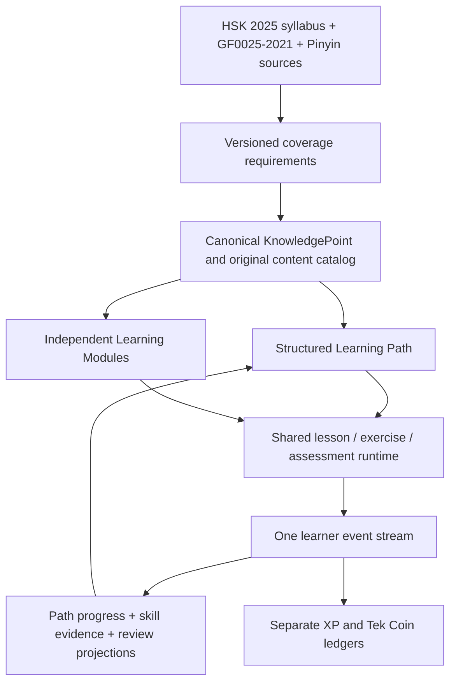

# Tekshe Phase 2 — 混合式课程与统一平台架构

## 已确认的产品架构决定

Tekshe 同时提供两种入口：

- **Structured Learning Path（主线课程）**：按 Level、Unit、Lesson 的教学顺序学习。
- **Independent Learning Modules（独立知识模块）**：允许自由进入拼音、汉字、词汇、语法、听说读写等知识模块。

两种入口不各自维护课程副本。它们引用同一 Curriculum Release、KnowledgePoint、Content Block、Exercise 和 Assessment ID；差异仅在入口、编排顺序和界面状态。

第一套完整教学产品是 HSK 1，长期采用新 HSK 三等九级框架扩展至 HSK 1–9。2025-11 HSK syllabus 与 GF0025—2021 是两个独立标准来源：HSK syllabus 决定考试覆盖项，GF 标准提供更广的能力/量化对照。它们之间使用有来源的 Crosswalk，不合并词表或数量。拼音作为 Tekshe 基础课程单独版本化，和 HSK 1 目标建立先修/关联关系，但不计入 HSK 官方词汇覆盖。

## 内容、路径和独立模块的关系



主线步骤只存 lesson/reference 和完成规则；独立模块只存知识点/内容/练习的引用。共享的知识内容只维护一次。

## 混合式学习进度规则

- 每次学习证据包含 knowledgePointIds、课程/内容版本和入口来源（path 或 independent）。
- 独立模块的讲解、练习和测评写入同一学习事件仓储，并可更新该学习者对应知识点的学习证据/掌握度。
- 主线视图读取同一知识点投影，展示“已接触/有练习证据/已达到目标”等状态，让独立学习成果可见。
- 独立模块的打开或单次作答**不自动等同于主线 Lesson 完成**。只有主线 Lesson 的指定 Assessment 已通过，或产品明确批准可互认的等价 Assessment 规则，才满足该步骤完成条件。
- 主线依赖关系应引用知识点或课程能力要求，并带有可解释的达标条件。用户可自由查看未解锁的独立模块，不因主线锁定而屏蔽知识内容。
- 课程完成、模块完成、单知识点掌握和奖励事件是不同事实，不互相隐式替代。

## 分层边界

1. **Standards & Coverage**：分别保存标准/版本/发布机构/生效时间/来源 locator；将标准中的任务、话题、词汇、汉字、语法条目拆成可追踪要求。
2. **Curriculum Catalog**：稳定 KnowledgePoint ID、学习目标、内容、例句、练习、测评、先修关系。哈萨克语解释和中文例句由 Tekshe 原创，状态标注审校。
3. **Path & Module Catalog**：结构化路径只编排 canonical 内容；独立模块做跨知识点入口与检索，不复制相同词条或例句。
4. **Shared Learning Runtime**：统一呈现教学、练习、反馈、Assessment、键盘/触屏状态和完成规则；不让页面自己创建另一套课程对象。
5. **Learning Event Service**：以事件记录学习事实；根据同一事件集生成主线路径进度、模块证据、错题、Review、mastery 与建议。
6. **Repository / Service Boundary**：Phase 2.1 先形成接口和本地适配层，继续兼容现有 localStorage；需要离线队列时再引入 IndexedDB。服务端实现延后到 Phase 2.5。
7. **Rewards**：XP 与 Tek Coin 独立；奖励只基于符合规则的真实活动，幂等事件 ID 防重。Mastery 和学习时长不计入货币。
8. **Backend & AI**：认证后服务端确定 userId/权限；AI 只在服务端验证身份、额度、请求体、课程范围后调用 provider。

## Phase 2.1 四项领域合同 v1

合同详情以 [PHASE_2_DATA_MODEL.md](./PHASE_2_DATA_MODEL.md) 为单一规范来源。实现或评审时不得在页面组件中另行定义相冲突的状态或完成规则。

| 合同 | 架构决定 | 关键保护 |
| --- | --- | --- |
| KnowledgePoint | 稳定语义 ID 与 `KnowledgePointRevision` 分离；CurriculumRelease 固定 revision 引用。 | 文案变更不换 ID；语义变化新建 ID；发布版不可原地覆盖。 |
| LearningEvent | `type` 判别的强类型事件联合，按 schemaVersion 校验，事件只追加。 | eventId 幂等；attemptId 标识独立尝试；路径/独立入口写入同一事件流。 |
| Assessment | 题目评分、目标分项、总分阈值、通过规则与版本一起发布。 | v1 样板默认总分 ≥80%、每个必需目标 ≥70%、必答项均已评分；不使用 UI 自算结果。 |
| Editorial Workflow | `draft → pending-review → reviewed → published`，修改审校意见返回 draft，新修改创建新 revision。 | 哈萨克语、中文教学和标准映射检查齐备后才发布；只有 published revision 进入运行时。 |

主线 Lesson 完成由固定版本的完成规则派生：必须满足路径先修并通过所有指定测评；Phase 2.1 仅接受 path 入口的合格 Assessment。Independent Module 的学习证据同步反映到 KP 和主线进度视图，但不自动完成主线 Lesson。若未来允许测评互认，必须在新 CurriculumRelease 中显式配置并审核。

## 统一课程树

```text
Curriculum Release
├── Standard references + coverage requirements
├── Level
│   └── Unit
│       └── Lesson
│           ├── Learning Objectives
│           ├── KnowledgePoint references
│           ├── Content Blocks
│           ├── Exercises
│           └── Assessments
├── Structured Learning Path (ordered references to Lessons)
└── Independent Modules (curated references to KnowledgePoints/Content/Exercises)
```

一个 KnowledgePoint 可以出现在多个 Lesson、独立模块和练习中。数据实体只有一份；主线和独立模块保存的是引用。跨标准的同义/等价知识点必须由显式 mapping 表说明来源和审核状态。

## 学习闭环及数据关联

| 环节 | 事件/数据 | 后续处理 |
| --- | --- | --- |
| Learn | session/lesson started、release、入口模式、目标 KPs | 确定学习范围，不自动发奖励 |
| Practice | exercise presented/submitted、题目版本、答题引用、KP、结果 | 给题目级证据；保留合理诊断所需的最少信息 |
| Assessment | attempt、分项成绩、覆盖的目标和评分规则版本 | 控制 Path Lesson 达标条件 |
| Error Analysis | 错题/易混点/技能标签和 KP 证据 | 解释错因并把明确薄弱项加入复习 |
| Spaced Repetition | review introduced/scheduled/graded、due date、算法版本 | 从学习事件生成可重算的 Review 投影 |
| Mastery | KP 证据量、近期结果、回忆等级、算法版本和置信度 | 证据不足时显示继续学习，不虚构精确掌握率 |
| Personalized Plan | 推荐课程/模块/Review 项、依据与计划版本 | 同时考虑 Path 先修、KP 薄弱证据、目标和用户选择 |
| Reward | 独立 XP/Coin 交易、规则版本、来源事件 | 服务端阶段以唯一键防重；不由 mastery 分数自动发奖 |

学习时间只按有开始/暂停/结束依据的 session 计算；XP、Tek Coin、Mastery、正确率和学习时长分别展示、分别解释。

## 三条工作流如何并行而不分裂

- **Learning System** 负责 HSK 1 标准映射、原创内容、KnowledgePoint、评估规则和真实教学目标。
- **User Experience** 从 Phase 2.1 建立 Design System，并为每个单元同步交付主线/独立入口、状态反馈和移动/桌面体验。
- **Technical Infrastructure** 同期定义稳定 ID、学习事件和 repository 边界；本地先行，不提前强制数据库/认证 provider。

并行工作的共同门槛是共享 ID 和 schema review：学习/UX 不能私造内容副本，基础设施不能另建一套知识 taxonomy。每个功能以一个 vertical slice 合并验收。

## UI/UX 规范基线

按产品负责人确认：浅冰蓝、薄荷青、暖白；柔和、清爽、低压力；移动端优先，桌面端完整；卡片、按钮、导航、字体、间距一致；动画轻且说明状态；不复制 Duolingo；保留 Tekshe 品牌和现有 Logo。

Phase 2.1 将现有 app/globals.css token 正式记录为 Design System v1，并逐页核对对比度、焦点、动态字号、窄屏和动效。课程界面优先级为目标/讲解 → 示例 → 练习 → 反馈/下一步；XP/Coin 不盖过教学信息。

## 技术与安全边界

- Phase 2.1/2.2 的静态课程数据仍随应用发布，课程内容先不用 CMS 或数据库。
- 客户端数据访问通过 repository/service contract；组件不直接读取所有 storage key。
- 登录前的匿名学习者 ID 只用于本机学习事件。未来登录迁移要有预览、备份和回滚；服务端授权以 session owner 为准。
- AI 当前 unavailable 状态保持诚实。接入前需服务端身份校验、实际请求字节上限、用户/全局限流、预算、超时、错误脱敏、输出 schema 验证、来源/版本标注和人工评测。
- AI 生成的题目不能自动伪装为官方 HSK 内容；课程解释及例句保持原创。任何外部 provider/API key 都要经后续产品批准。
